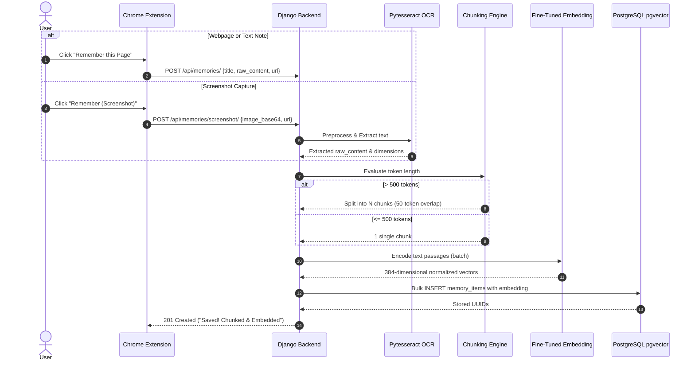
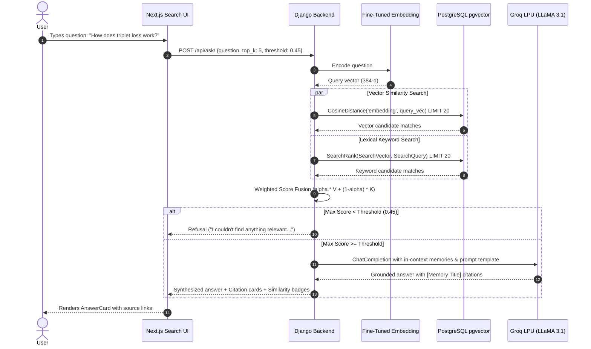

# Recall: System Architecture & Data Flow

This document details the architectural layout, data flow schemas, and component interactions of the Recall AI memory system.

---

## 1. High-Level Architecture Diagram

```
+-----------------------------------------------------------------------------------+
|                            CLIENT SURFACES LAYER                                  |
|                                                                                   |
|  +-------------------------------------+   +------------------------------------+  |
|  |     Chrome Extension (MV3)          |   |     Next.js 14 Frontend Web App    |  |
|  | - One-Click DOM Text & URL Capture  |   | - Natural Language Search (/api/ask) |  |
|  | - Context Menu: "Remember this"    |   | - Grounded Answer Card with Sources|  |
|  | - captureVisibleTab() Screenshot    |   | - Memory Manager & Type Filters    |  |
|  +-------------------------------------+   +------------------------------------+  |
+------------------------------------------+----------------------------------------+
                                           | HTTP REST
                                           v
+-----------------------------------------------------------------------------------+
|                        BACKEND SERVICE LAYER (Django DRF)                         |
|                                                                                   |
|  [POST /api/memories/]         [POST /api/memories/screenshot/]   [POST /api/ask/]|
|         |                                      |                          |       |
|         v                                      v                          v       |
|  +---------------+                     +---------------+          +---------------+
|  | Token Chunker |                     | pytesseract   |          | Hybrid Search |
|  | (>500 tokens) |                     | OCR Engine    |          | Retrieval     |
|  +---------------+                     +---------------+          +---------------+
|         |                                      |                          |       |
|         +-------------------+------------------+                          |       |
|                             |                                             |       |
|                             v                                             v       |
|                  +----------------------+                      +------------------+
|                  | Embedding Singleton  |                      | Groq LPU Client  |
|                  | (all-MiniLM-L6-v2    |<-------------------->| (LLaMA 3.1)      |
|                  |  recall-finetuned-v1)|                      | + Guardrail      |
|                  +----------------------+                      +------------------+
|                             |                                             |       |
+-----------------------------|---------------------------------------------|-------+
                              | Vectors (384-d)                             | Citations
                              v                                             v
+-----------------------------------------------------------------------------------+
|                        DATABASE LAYER (PostgreSQL 16)                             |
|                                                                                   |
|  +-----------------------------------------------------------------------------+  |
|  | Table: memory_items                                                         |  |
|  | - id (UUID, PK)                                                             |  |
|  | - source_type ('text' | 'webpage' | 'screenshot' | 'pdf')                    |  |
|  | - title (VARCHAR)                                                           |  |
|  | - raw_content (TEXT)                                                        |  |
|  | - source_url (VARCHAR)                                                      |  |
|  | - embedding (vector(384) with HNSW Cosine Index <=> )                       |  |
|  | - chunk_index (INT), parent_id (UUID)                                        |  |
|  | - Full-Text Search Vector (SearchVector on title + content)                 |  |
|  +-----------------------------------------------------------------------------+  |
+-----------------------------------------------------------------------------------+
```

---

## 2. Ingestion Data Flow



---

## 3. Query & Synthesis Flow (/api/ask/)



---

## 4. Key Endpoints Reference

| Endpoint | Method | Input | Output | Purpose |
|---|---|---|---|---|
| `/api/memories/` | `GET` | `?page=1&source_type=pdf` | Paginated list | Browse and filter memories |
| `/api/memories/` | `POST` | JSON note or file upload | 201 Created MemoryItem | Text/file ingestion & chunking |
| `/api/memories/screenshot/` | `POST` | `{image_base64, title, url}` | 201 Created MemoryItem | Screenshot OCR + 384-d vector ingest |
| `/api/memories/<uuid>/` | `DELETE` | Path UUID | 204 No Content | Delete memory |
| `/api/search/` | `POST` | `{query, top_k, alpha, mode}` | Ranked candidate items | Hybrid semantic + keyword retrieval |
| `/api/ask/` | `POST` | `{question, top_k, threshold}` | Grounded answer + citations | Groq LPU RAG synthesis |
